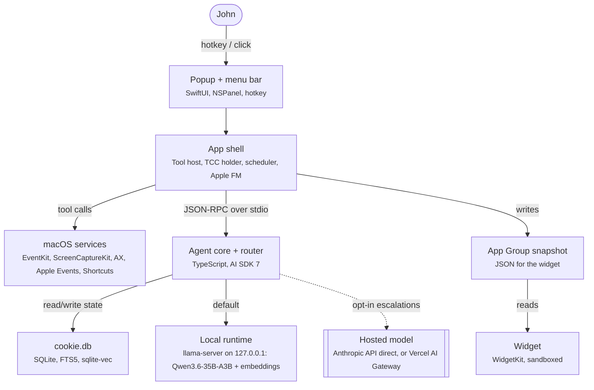

# Cookie

**Status:** pre-alpha, design phase.

A good dog for your Mac.

Cookie is a small, friendly companion that lives in your menu bar. Ask about whatever's on your screen, keep your calendar and reminders straight, and let it handle small Mac chores, all on a model running on your own machine. Cookie only reaches for the cloud when you say so, and it tells you every time.

⌥Space to ask · remembers what matters · asks before it acts · open source

Named after (and drawn like) a real white maltipoo.

Requires Apple Silicon, macOS 14 or later, about 25 GB free, and 32 GB or more of RAM for the default local model. That RAM line is a placeholder until the smallest supported Mac is tested.

The planned Homebrew install, once a cask is published in `johnkimec/homebrew-tap`, is:

```bash
brew install --cask johnkimec/tap/cookie-agent
```

Not affiliated with "Cookie", the browser-cookie manager by SweetP Productions.

The plan is approved in [docs/cookie-agent.md](docs/cookie-agent.md). The M0 Mac shell lives in [app/](app/README.md): a menu bar, an ⌥Space popup, and a supervisor for the fake core. Launch that executable with `COOKIE_DATA_DIR` and `COOKIE_LLAMA_PORT=18080` set. Do not point those at a real Cookie instance.

## Architecture

The Swift shell is the only process that touches TCC-protected APIs. The TypeScript core owns reasoning, memory, routing, and policy. `llama-server` is a third process. The hosted model is dashed because it is off until John opts in.



## Docs

- [Project doc](docs/cookie-agent.md) — technical design and decision log. Status must read `approved` before implementation.
- [UI, branding, and packaging](docs/cookie-agent-ui-spec.md)
- [AGENTS.md](AGENTS.md) — how to work in this repo
- [Brand](BRAND.md) — Cookie's name and mascot art are not under the code license
- [License](LICENSE) — Apache-2.0 for the code, copyright 2026 John Kim
