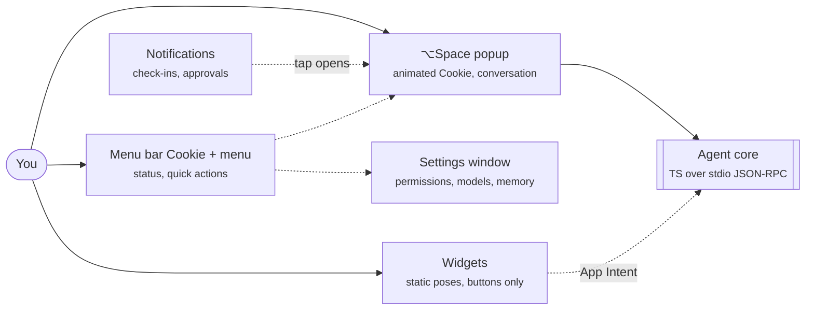

# Cookie: UI, branding and packaging spec

> Cookie, the menu-bar companion: name check, a white maltipoo mascot and its animation states, the animation tool pick, voice, every surface, the key flows and open-source packaging. It sits alongside the technical design doc and doesn't change the architecture there.

This spec builds on the technical design doc, and stays consistent with it. That means a Swift shell (MenuBarExtra, a non-activating popup on ⌥Space, WidgetKit, notifications) and a TS agent core. It also means a local Qwen3.6-35B-A3B model by default, the cloud only on escalation, the T0/T1/T2 permission tiers and a local-only toggle.

- [Cookie: technical design doc](./cookie-agent.md) — in this repo

**Contents**

- [1. Brand: Cookie](#brand)
- [2. Cookie character sheet](#character)
- [3. Animation tech](#animtech)
- [4. Personality and voice](#voice)
- [5. Visual system and icon states](#visual)
- [6. Surfaces](#surfaces)
- [7. Key flows](#flows)
- [8. Open-source packaging](#packaging)
- [9. Decisions and open questions](#decisions)
- [Sources](#sources)

<a id="brand"></a>

## 1. Brand: Cookie

_Decided by John: Cookie, after his dog. These conflict checks are web searches, `github.com/<name>` lookups and Homebrew cask API lookups from 24 Oct 2026. They are not a trademark search._

- **Name:** Cookie (decided)
- **Mascot:** A white maltipoo (maltese × poodle), flat and low-detail, animated (decided)
- **Tagline options:** "A good dog for your Mac." · "Fetches the small stuff." · "Your Mac's best friend."
- **One-line personality:** Warm, attentive and a little dry. Glad to see you, and it never jumps on the furniture.

| Check | Result | Impact |
| --- | --- | --- |
| Existing Mac app named Cookie | Yes. Cookie by SweetP Productions is a long-running Mac browser cookie and privacy manager. It's on the Mac App Store and cookieapp.com, ships as Cookie.dmg and installs Cookie.app. | High: same platform, same app name, and it's also a privacy product |
| Homebrew cask token `cookie` | Taken by SweetP's Cookie (homebrew/cask, installs /Applications/Cookie.app). | High: you can't use the plain token |
| Bundle name collision | If someone has both apps, two apps would be named Cookie.app in /Applications. | Avoid: ship a different .app filename |
| AI-companion products | Cookie OS is a hackathon project (a sandboxed-VM AI companion) on the Synthesis showcase. Pocket Chief, a Mac desktop AI companion, calls its in-app credits "Cookies". I didn't find a shipping Mac AI assistant named Cookie. | Low–medium |
| Searchability | "cookie" is a core web term (browser cookies, cookie banners), so "Cookie Mac app" searches will be dominated by cookie managers and privacy articles. | Medium: needs a qualifier |
| GitHub user/org handles | Taken: `cookie`, `getcookie`, `cookieapp`, `cookie-ai`, `cookiebuddy`, `heycookie`. The user/org handle `cookie-agent` also exists. The chosen repo, github.com/johnkimec/cookie-agent, already exists too (returned 200 on 24 Oct 2026). Confirm it's yours. | Fine: the repo lives under johnkimec |
| Homebrew `cookie-agent` | There's no homebrew/cask token and no homebrew/core formula named `cookie-agent` (both formulae.brew.sh API lookups returned 404 on 24 Oct 2026). | Fine |

> **Decided: Cookie inside the app, cookie-agent outside it** The UI, menu bar and onboarding just say "Cookie". Plain "Cookie" can't be the outside name, because SweetP's Cookie already owns Cookie.app and the Homebrew cask token cookie. Outside names: app file Cookie Agent.app, repo github.com/johnkimec/cookie-agent, cask cookie-agent in the johnkimec/homebrew-tap tap, install with brew install --cask johnkimec/tap/cookie-agent. The qualifier avoids the Cookie.app clash, says what the product is and gives people a searchable phrase. Avoid "Cookie for Mac", because SweetP's site already titles itself "Cookie — Browser Cookie Manager for Mac". Run a CIPO/USPTO trademark search before launch, since SweetP has a long-standing Mac product with this name.

Considered before John decided: Solderbug, Pocket Ohm, Lampwick, Wisp and Hearth. Wisp and Hearth were crowded with existing Mac or AI apps. These are kept only for reference.

<a id="character"></a>

## 2. Cookie character sheet

Style: flat vector, a few rounded shapes, no fur texture, no gradients. It's a fluffy cloud silhouette (maltipoo curls read as bumps on the outline, not as texture), with two dot eyes, a small dark nose and an optional tongue. The sketch below is a rough preview of the shape language, not final art. Use the selector to see each state's static pose, which is also the Reduce Motion fallback.

_Interactive in the Page: a pose selector (Idle · Listening · Thinking · Talking · Happy · Needs you · Sleeping · Error · Offline) and an SVG sketch preview shown at three sizes: Popup / onboarding (colour), Widget / reply avatar, Menu bar, 18 / 16 px template. Not exported; the pose of each state is described in the tables below._

| Part | Spec |
| --- | --- |
| Head | 5–7 overlapping circles that merge into one cloud silhouette. Its outline is the only place the curls appear. |
| Ears | Two long rounded ovals hanging beside the head. They're the main expressive part (perk, tilt, droop) and stay readable at 16 px. |
| Face | Two solid dot eyes, a small rounded nose and no mouth line by default. A small pink tongue is optional for the talking and happy states. |
| Body | Optional and only at popup or onboarding sizes: a rounded loaf with a tail puff. Widgets and avatars are head only. |
| Colour | Off-white fur, one darker single-tone shadow shape (for example under the chin) and near-black eyes and nose. The palette is final-art only. In the app, use asset-catalog colours with light and dark variants. |
| Light backgrounds | A white dog disappears on white. Give it a 1.5–2 pt mid-grey outline, or put it on a subtle rounded backdrop tile. On dark backgrounds the outline can be lighter or dropped. |
| Menu bar | A separate monochrome silhouette (head and ears, plus a negative-space eye notch) exported as a template image so macOS tints it. Test it at 16 and 18 px. Dot eyes may merge into the silhouette at that size, which is fine. |
| Don't | Fur strands, more than one shadow, gradients, outlines thinner than 1 px at the smallest size, or tiny details that alias at 16 px. |

Animation states, mapped to app states. Loops are short and subtle. Reduce Motion swaps every state to its static pose.

| Cookie state | App state | Motion (≤ 1.5 s loops) | Reduce Motion |
| --- | --- | --- | --- |
| Idle | Nothing happening | Slow breathing (2–3% scale). A blink every 4–8 s at random, and an occasional ear twitch (about once a minute). | Static, eyes open |
| Listening | Popup open, input focused, or voice | Ears perk up and the head tilts 8°, then holds. Ends with one small bob. | Perked, tilted pose |
| Thinking | Agent loop running | Head tilts the other way and the eyes look up. One paw taps, about 1 s per loop. | Looking-up pose with a two-dot thought mark |
| Talking | Reply streaming | Small mouth or tongue open and close, synced roughly to streamed chunks, not phonemes. | Static mouth-open |
| Happy / done | Action completed | Tail wag twice plus happy ^ ^ eyes, then back to idle. Plays once, not looped. | Happy pose for 1.5 s |
| Needs you | A T1/T2 card or check-in waiting | A gentle bounce or a single paw wave, repeating every 6 s at most. | Paw-raised pose plus a badge |
| Sleeping | Local-only idle, Do Not Disturb or Focus, or low battery mode | Eyes closed, very slow breathing and a small "z". | Eyes closed, static |
| Error | Tool failure or model crash | Ears droop and the head dips once. | Drooped pose |
| Offline | No network (local still works) or the model isn't loaded | No motion. A dimmed pose with a slash mark. | Same |

<a id="animtech"></a>

## 3. Animation tech

_Facts are from vendor docs and the pages linked in Sources. Vendor size claims are marked as claims. CPU and battery numbers for Cookie still need to be measured on the M1 Max._

|   | Rive (rive-ios) | Lottie (lottie-ios) | SwiftUI-native shapes |
| --- | --- | --- | --- |
| Mac support | The Apple runtime supports macOS 13.1+ through SwiftPM (the same rive-ios package), with AppKit and SwiftUI | macOS 10.15+; LottieAnimationView is an NSView on macOS | Built in. PhaseAnimator and KeyframeAnimator need macOS 14+ |
| State machine | Built into the file. The app sets inputs or data-bound properties (for example `state = thinking`) and the file handles transitions and blends | Plain Lottie JSON has none, so the app plays segments in code. The dotLottie format adds state machines through a separate runtime; I didn't verify its macOS support | You write the state logic in Swift |
| File size | Compact binary .riv. Rive says files are often 10–15× smaller than equivalent Lottie JSON (vendor claim) | JSON. dotLottie zips it | No asset files; it's all code |
| Runtime cost | Adds a native runtime. A third-party guide citing Rive's docs puts the iOS arm64 download impact at about 1.67 MB. Small next to a 22 GB model | Adds the Lottie library | None |
| Energy | State machines settle and stop advancing when nothing is animating. Rive's docs describe this as saving performance and energy | Stops when paused. The app controls playback | SwiftUI only animates while a transaction or animator is active |
| Authoring | Rive Editor, with bones, state machines and data binding. Free exports play a Rive splash screen; the Cadet plan ($9/seat/mo) removes it | After Effects plus an exporter, or LottieFiles' tools | Xcode only. Fine for simple shapes, tedious for organic motion |
| Licence | Runtimes are MIT; the editor is proprietary | lottie-ios is open source (check the licence in the repo before release) | Apple SDK |

Decided: Rive for the Cookie character in the popup, onboarding and Settings. Cookie is a state-driven character, and Rive's file-level state machine maps one-to-one to the table above. The shell just sets one input per app state, and idle settling keeps it cheap. The tradeoffs are the proprietary editor and the $9/mo plan to ship without the splash screen.

Placeholder: until cookie.riv is ready, a static SwiftUI pose can stand in.

- **Menu bar:** Never run a live animation there. Use static template images, one per state. For Thinking, a cheap 2–3-frame swap of the NSStatusItem image at 2–4 fps is acceptable, and under Reduce Motion it becomes static.
- **Widgets:** WidgetKit renders static snapshots, so use one exported static pose per state (PDF/SVG vector assets), not Rive.
- **Popup:** Animate only while the popup is visible. Pause the Rive view when it closes. Cap at 60 fps, and drop to static Sleeping when on battery with Low Power Mode on.
- **Budget:** Target: idle popup animation costs less than 2% of one CPU core on the M1 Max (measure with Instruments). The model is the energy hog; the mascot must not show up in Activity Monitor.

<a id="voice"></a>

## 4. Personality and voice

_Extends the Personality section of the design doc (warm, brief, a little dry; persona.md)._

- **Core:** Warm, brief, a little dry. A friend who's good with computers. Cookie speaks in first person as Cookie, not as a dog.
- **Dog flavour:** Light and occasional: "fetched", "I'll keep an eye on it", happy to see you in the morning. At most one dog-flavoured phrase in any 10 replies.
- **Never:** "Woof" in normal replies, constant puns, baby talk, excessive exclamation marks, or doggy wording in errors, privacy labels or T2 confirmations.
- **Length:** 1–3 sentences by default. Lists only when asked or when there are 3+ items.
- **Questions:** At most one question per reply.

- **Actions:** Says what it did, in past tense, and offers undo.
- **Silence:** Silence is a feature. No "just checking in!" without a reason.
- **Honesty:** Says "I don't know" or "I can't see that window" plainly.
- **Privacy:** Every reply carries an on-device or cloud label, in plain words.
- **Source of truth:** `persona.md` in the profile. The dials below rewrite one block of it.

Try the dials. These two settings ship in Settings → Personality.

_Dial in the Page: Calm · Playful._

_Dial in the Page: Quiet · Proactive._

| Moment | Calm (default) | Playful |
| --- | --- | --- |
| Greeting | Good morning. Three things today; the first is at 10. | Morning! Three things today. I fetched your agenda, so the first one's at 10. |
| Check-in | You've had the datasheet open for 50 minutes. I can summarise the timing table if that helps. | You've been deep in that datasheet for 50 minutes. Want me to pull the timing table out of it? |
| Confirming an action (T1) | Move "Lab 4 report" to Thursday at 4 pm? | I'll move "Lab 4 report" to Thursday 4 pm. Okay? |
| After the action | Done. Undo is available for 10 minutes. | Moved. If Thursday-you objects, Undo is right here. |
| Error | I couldn't reach Calendar. Nothing was changed. | Calendar didn't answer, so I didn't change anything. Try me again in a bit? |
| Privacy label | On-device. Nothing left your Mac. | On-device. Nothing left your Mac. |
| Privacy label (cloud) | Cloud: sent your question and the visible window text to Claude Sonnet 5.5. Not the screenshot. | Cloud: sent your question and the visible window text to Claude Sonnet 5.5. Not the screenshot. |

- Check-in policy at "quiet": No unprompted check-ins. You only get the morning brief if you open the popup. Deadlines still arrive as the normal reminders you created.
- Check-in policy at "proactive": Up to 3 check-ins a day: a morning brief, one mid-day nudge tied to a real signal (a deadline or a long focus block) and an evening wrap. Never during a meeting, a Focus mode or screen sharing.

| Dial | Options | Default | What it changes |
| --- | --- | --- | --- |
| Tone | Calm · Playful | Calm | Persona block and phrasing. Playful allows the light dog flavour and at most one light line per reply. Calm has almost none. |
| Reach | Quiet · Proactive | Quiet for the first week, then Cookie offers Proactive once | Scheduler check-in budget and notification categories |
| Mascot motion | Full · Subtle · Still | Subtle | Animation intensity. Still matches Reduce Motion even when that system setting is off |
| Verbosity | Terse · Normal | Normal | Max tokens, and whether a reply ends with a suggested next step |

<a id="visual"></a>

## 5. Visual system and icon states

Surfaces use the hybrid approach. The mascot is the character in the popup, onboarding, empty states and app icon. The menu bar and the small widget use a simplified Cookie head silhouette. Everything else is plain system UI.

| State | Menu bar template glyph | Motion in menu bar | Trigger |
| --- | --- | --- | --- |
| Idle | Cookie head silhouette, ears down | None | Default |
| Listening | Ears raised | None (static swap) | Popup open or voice input active |
| Thinking | Head plus a small 2-dot mark | Optional 2–3-frame dot swap at 2–4 fps; static under Reduce Motion | Agent loop running (local or cloud) |
| Needs you | Head plus a filled badge dot | None. The badge is the signal | Pending T1/T2 confirmation or a check-in waiting |
| Sleeping / local-only | Eyes-closed head plus a small lock notch when local-only | None | Local-only toggle on, or Focus/DND |
| Offline / model loading | Head with a slash (offline) or a dotted outline (loading) | None | No network, or a llama-server reload (9 s warm / 27 s cold on the M1 Max) |
| Error | Ears drooped | None | Last action failed (clears when the popup opens) |

- **Colour:** System accent and semantic colours for the UI. Cookie's off-white, shadow and nose colours live only in the mascot assets and app icon.
- **Light/dark:** Mascot assets have light and dark variants: an outlined Cookie on light backgrounds, an outline-optional Cookie on dark. UI chrome uses system materials only.
- **Badges:** On-device shows a chip icon with a secondary label; cloud shows a cloud icon in the accent colour. The text label is always present.
- **App icon:** Cookie's head on a soft rounded-square backdrop, following the current macOS icon grid. Make it a separate, more polished asset than the in-app sketch.

- **Motion:** UI transitions under 250 ms with no bounce. Cookie's motion is the only playful movement, so keep the chrome still.
- **Reduce Motion:** Check `NSWorkspace.shared.accessibilityDisplayShouldReduceMotion`. When it's on, Cookie uses static poses and slides become cross-fades.
- **HIG:** Template image for the menu bar extra, standard menu items, full keyboard navigation and respect for Focus.
- **Accessibility:** VoiceOver labels such as "Cookie, thinking". The mascot is decorative in the popup, so its state is also given as text.

<a id="surfaces"></a>

## 6. Surfaces



<a id="menubar"></a>

### 6.1 Menu bar menu

A standard `MenuBarExtra` menu. Option-click the icon to open the popup directly.

```text
┌──────────────────────────────────────┐
│ 🐾 Cookie · on-device · Qwen3.6      │  status line (disabled item)
│   Next: ECE 361 lecture, 10:00       │
├──────────────────────────────────────┤
│ Ask Cookie…                  ⌥Space │
│ Ask about this window…      ⌥⇧Space │
│ Today's brief                        │
├──────────────────────────────────────┤
│ 1 thing waiting for you  ›           │  only when Needs-you
├──────────────────────────────────────┤
│ ✓ Local-only mode                    │
│   Quiet time  ›  1h · Today · …      │  Cookie shows Sleeping
├──────────────────────────────────────┤
│ Memory…                              │
│ Settings…                        ⌘, │
│ Quit Cookie                      ⌘Q │
└──────────────────────────────────────┘
```

<a id="popup"></a>

### 6.2 Hotkey popup

- **Window:** Non-activating `NSPanel` (as in the design doc), floating level, centred in the upper third of the active screen.
- **Size:** 560 pt wide. With no reply the panel is the input row, 64 pt tall (under 80 pt): the 22 pt field, the 40 pt Cookie, and one 8×8 on-device dot. It grows with the transcript up to `PopupLayout.maxHeight`, 320 pt, then the transcript scrolls inside and stays pinned to the bottom. 320 pt is the upper third of a 13-inch MacBook (default canvas 1470×956 pt; after the menu bar that band is about 300 pt) and still fits that band on a 14-inch display. That is the input row plus about eleven 22 pt lines. The last transcript line sits 8 pt above the input row. The follow-bottom marker occupies that inset and does not leave a blank band. The input row stays 64 pt for a one-line draft; the transcript takes the extra height. Reply text wraps inside the column, including markdown and the inline math in that paragraph.
- **Cookie:** A 40 pt animated head at the left of the input row, driven by the state table. It's the only animated thing in the panel.
- **Open/close:** ⌥Space toggles it (rebindable) and Esc closes it. Clicking outside closes it unless an action card is pending. The draft is kept for 10 minutes.
- **Input:** Single line that grows to 5 lines. ⏎ sends, ⇧⏎ adds a newline, ↑ edits the last message, ⌘K clears.
- **Screen chip:** Shows something like "Safari · Lab 4 handout" when you use ⌥⇧Space or type "this". Click the chip to drop it. Without the chip, no screen content goes into the prompt.
- **On-device dot:** One 8×8 dot in the input row while the runtime is up, labelled `on-device`. Not a badge on each reply.

```text
┌────────────────────────────────────────────────────────┐
│ [▣ Safari · Lab 4 handout  ×]          on-device ◦      │  context chip + 8 pt on-device dot
├────────────────────────────────────────────────────────┤
│ you     what's the setup time in table 3?               │
│                                                        │
│ cookie  2.1 ns min at 3.3 V (row "tSU"). The 1.8 V      │
│         column is blank in this PDF.                    │
│                                                        │
│ ┌ ACTION · T1 ─────────────────────────────────────┐   │
│ │ Add reminder "Check tSU at 1.8 V" · Tomorrow 9am │   │
│ │ List: School                                     │   │
│ │ [ Do it ⏎ ]  [ Edit ]  [ Not now esc ]           │   │
│ │ ☐ Don't ask again for reminders                  │   │  T1 only; never shown for T2
│ └──────────────────────────────────────────────────┘   │
├────────────────────────────────────────────────────────┤
│ (•ᴥ•)  Ask Cookie…                              ⏎      │  animated Cookie, 40 pt
└────────────────────────────────────────────────────────┘
```

| Card | Shows | Buttons | Rules |
| --- | --- | --- | --- |
| T0 read | Nothing (inline citation only, for example "from Calendar") | — | Never blocks |
| T1 reversible | Verb, target, key fields and the app it touches | Do it · Edit · Not now; an optional "don't ask again" per tool | After you approve, an Undo chip stays for 10 minutes. Cookie plays Happy once |
| T2 irreversible / external | Full payload (for example the email body), recipients, a warning icon, and "tainted input" if the plan came from screen or web text | Review → Confirm (two steps; ⏎ doesn't confirm) | Always asks and can't be made trusted. Cookie holds the static Needs-you pose with no playful motion |

<a id="widgets"></a>

### 6.3 Widgets

WidgetKit widgets are sandboxed. They render a timeline from the App Group JSON snapshot and can only run `Button` or `Toggle` App Intents (macOS 14+). They can't take text input, stream or play custom animation, so Cookie appears as a static pose that matches the current state.

| Size | Shows | Interactive | Tap target |
| --- | --- | --- | --- |
| Small | Cookie pose (state), the next event and its time, and one line from the morning brief | None | Opens the popup |
| Medium | Small Cookie avatar, the next 2 events, the top 3 reminders and an "N things waiting" badge | Button: complete a reminder (T1, pre-trusted only). Button: Ask (opens the popup) | A row opens the popup with that item as context |
| Large | Today brief (3–5 lines), agenda, reminders and Cookie's last check-in note | Buttons: complete a reminder, snooze a check-in. Toggle: local-only | Opens the popup |
| Extra large | Probably skip for v1 | — | — |

Refresh: the shell writes the snapshot and calls `WidgetCenter.shared.reloadTimelines` after calendar or reminder changes, and at most every 15 minutes otherwise. Widgets never call the model.

<a id="notifications"></a>

### 6.4 Notifications and check-ins

| Category | Example | Actions | Delivery |
| --- | --- | --- | --- |
| Morning brief | Three things today; the first is ECE 361 at 10. | Open · Snooze 1h | Once, at your wake window, only if Reach = Proactive |
| Nudge | Lab 4 is due in 6 h and the doc hasn't changed since Tuesday. | Open · Not today | At most 1 mid-day. Suppressed during Focus, meetings and screen sharing |
| Approval waiting | Send the reply to Prof. Lee? (T2) | Review (opens the popup; never approves from the banner) | Time-sensitive only for T2 actions you started |
| Done in background | Moved 2 reminders to tomorrow. Undo? | Undo · Open | Passive interruption level |
| Evening wrap | You finished 4 of 6. Carry the rest over? | Carry over (T1) · Open | Proactive only |

Rules: a hard daily cap (3 by default), and every notification states its reason. "Why did I get this?" in the popup shows the trigger. No notification can approve a T2 action. The notification icon is the app icon, so the mascot doesn't need its own asset here.

<a id="settings"></a>

### 6.5 Settings window

| Pane | Contents |
| --- | --- |
| General | Hotkeys (⌥Space, ⌥⇧Space), launch at login (SMAppService), updates (Sparkle: auto-check, channel) |
| Cookie | Personality dials (Tone, Reach, Verbosity), mascot motion (Full · Subtle · Still) and a live preview of Cookie with a sample line |
| Permissions | One row per permission: a status dot, why it's needed, the feature it unlocks and an "Open System Settings" button. Screen Recording also shows the next expected re-prompt date (Sequoia re-prompts monthly). |
| Models | Local model card (name, size, licence, tok/s measured on this Mac, RAM used, Unload now), download or replace a model, keep-alive minutes, and battery mode (Apple Foundation Models on macOS 26+). Cloud: provider (Anthropic direct or Vercel AI Gateway), key in the Keychain, a monthly spend cap and an "ask before every cloud call" checkbox. |
| Local-only | One big toggle. When it's on, the cloud provider is disabled and escalations fail closed with an explanation. Cookie's menu bar glyph shows the lock notch. |
| Memory | Viewer and editor: profile (editable persona.md), facts (search, edit, delete, pin, source link), journal by day, "Forget everything about…" and full export or wipe. |
| Tools & trust | Every tool with its tier, a trusted toggle for T1 (T2 is locked), per-app Automation status and an action log with undo |
| Privacy | Cloud call log (what was sent, when, tokens, cost) and a link to PRIVACY.md |

<a id="flows"></a>

## 7. Key flows

<a id="firstrun"></a>

### 7.1 First run: Cookie introduces itself

Principle: start the 20–22 GB model download first, because it takes longest, then ask for permissions just in time, cheapest and most obviously useful first. Every permission can be skipped. The feature it unlocks stays visibly off until it's granted.

1. **Hi, I'm Cookie** — Cookie trots in and sits (with a static pose under Reduce Motion). "Hi, I'm Cookie. I live in your menu bar, I run on your Mac by default, and I only use the cloud when you let me." Buttons: Get started · Read privacy.
2. **Model download** — "First I need my on-device brain. It's big, so I'll fetch it while we set up." Card: Qwen3.6-35B-A3B Q4_K_M (~21 GB, Apache 2.0, from Hugging Face), free disk space and a destination. The download is resumable, verified with SHA-256, and keeps going in the background. Alternatives: Gemma 4 26B A4B (14.6 GB), or skip and use the cloud only.
3. **Notifications** — "So I can tap you on the shoulder, rarely." Why: check-ins and approval prompts. Low stakes, so this one comes first.
4. **Calendars & Reminders (EventKit full access)** — Why: the brief, scheduling and reminders are the daily core. Cookie shows today's agenda straight away as a quick win.
5. **Screen Recording (ScreenCaptureKit)** — Why: "what's on my screen" questions. Explain that Cookie only looks when you ask, that captures stay on-device unless you escalate, and that macOS re-asks monthly. This needs a relaunch, so offer Grant & relaunch (Cookie waves goodbye and comes back).
6. **Accessibility** — Why: reading focused-window text and doing Mac actions (clicks, typing). It's the most powerful permission, so it comes last, and it's the reason the app isn't sandboxed.
7. **Automation (Apple Events)** — Not requested during onboarding. macOS asks per app (Mail, Music, Finder…) the first time a tool targets it, with a pre-prompt from Cookie explaining why.
8. **Hotkey + personality** — Confirm ⌥Space, pick Calm or Playful, and pick mascot motion. Reach starts as Quiet.
9. **Ready** — If the download isn't finished: "You can use me with the cloud now, or wait. I'll let you know when I'm fully on-device." (Unavailable in local-only mode.)

```text
┌ Fetching Cookie's on-device brain ─────────────────┐
│ (•ᴥ•)  Qwen3.6-35B-A3B · Q4_K_M · Apache 2.0        │  Cookie in Thinking loop
│ ███████████████░░░░░░░░░░░  12.4 / 21.0 GB  59%     │
│ 38 MB/s · about 4 min left · verifying after        │
│ Saving to ~/Library/Application Support/Cookie/     │
│ [ Pause ]  [ Use smaller model ]  [ Continue setup ]│
└─────────────────────────────────────────────────────┘
```

Download states: queued, downloading, paused, resuming, verifying, ready (Cookie plays Happy), failed (checksum mismatch, so delete and retry; Cookie plays Error) and low disk (needs ~25 GB free). The sizes and speeds in the wireframe are illustrative.

<a id="otherflows"></a>

### 7.2 Other flows

| Flow | Steps |
| --- | --- |
| Ask about the screen | ⌥⇧Space → Cookie perks up (Listening) and the chip shows the front window → you type → Thinking → the local model gets the AX text, plus an OCR or vision crop if needed → Talking → reply badged on-device. If it needs to escalate: "This needs the cloud model. Send the question and window text (not the image)?" with Send / Stay local, unless you've pre-allowed it. Refused in local-only mode. |
| Check-in | The scheduler finds a signal → checks the budget, Focus and meetings → posts a notification with its reason → a tap opens the popup with the check-in as Cookie's first message → you reply or dismiss → "Not today" teaches the scheduler (logged in the journal). |
| Risky action (T2) | Cookie proposes it → a T2 card with the full payload, plus a taint banner if screen or web text influenced the plan → Review → Confirm is enabled after 1 s → it executes → the result and an action-log entry appear. Cancel tells the agent "declined" and it doesn't retry. |
| Memory review | Weekly (Sunday, optional) or on demand: "Things I learned about you this week" lists new facts with Keep / Edit / Forget. The full editor is in Settings → Memory, and every fact links to its source conversation. |

<a id="packaging"></a>

## 8. Open-source packaging

<a id="license"></a>

### 8.1 License

| License | Lets others… | Tradeoff for you |
| --- | --- | --- |
| MIT | Do anything, including closed commercial forks, with attribution | Simplest. No patent grant |
| Apache-2.0 (recommended for code) | Same as MIT, plus an explicit patent grant and a NOTICE file | Matches the default model licences (Qwen3.6 and Gemma 4, per the design doc). Still allows closed forks |
| GPL-3.0 | Use and modify, but distributed forks must stay GPL | Blocks closed forks, deters corporate contributors and makes a later paid tier harder |

Brand assets are separate from the code. Cookie is your real dog, so keep the name, mascot artwork and Rive files out of the Apache-2.0 grant. Put them under a short BRAND.md ("all rights reserved; forks must rename and use their own mascot"), or under CC BY-NC-ND if you want people to be able to share them. Use a DCO (Signed-off-by) for code contributions.

<a id="repo"></a>

### 8.2 Repo

Repo (decided): github.com/johnkimec/cookie-agent. Homebrew tap: github.com/johnkimec/homebrew-tap. Structure:

Superseded by [D-2026-10-24-13](./cookie-agent.md#decision-log): the foundation layout (`app/`, `core/`, `protocol/`, `evals/`, `assets/`) replaces this sketch.

```text
cookie-agent/
├─ apps/mac/                 Swift shell (Xcode project / SwiftPM)
│  ├─ App/                   MenuBarExtra, popup NSPanel, settings
│  ├─ Widget/                WidgetKit extension (sandboxed)
│  ├─ Intents/               App Intents shared by widget + Shortcuts
│  └─ Resources/             persona.md default, asset catalog
├─ brand/                    NOT Apache-2.0, see BRAND.md
│  ├─ cookie.riv             Rive file: one state machine, 9 states
│  ├─ poses/                 static pose PDFs/SVGs (widgets, Reduce Motion)
│  ├─ menubar/               template glyphs @16/@18 px, per state
│  └─ appicon/
├─ core/                     TS agent core (AI SDK, tools, memory)
│  ├─ src/tools/             one file per tool, tier declared inline
│  ├─ src/memory/            SQLite schema + migrations
│  └─ test/evals/            evaluation set from the design doc
├─ runtime/                  llama-server build script, model manifest
│  └─ models.json            name, URL, size, sha256, license
├─ scripts/                  build, sign, notarize, appcast, release
├─ docs/                     architecture (link to design doc), privacy
├─ .github/workflows/        CI: test, build, sign+notarize on tag
├─ README.md  LICENSE  NOTICE  BRAND.md  PRIVACY.md
├─ CONTRIBUTING.md  CODE_OF_CONDUCT.md  SECURITY.md
└─ THIRD_PARTY_NOTICES.md
```

README pitch (draft):

```text
# Cookie 🐾
A good dog for your Mac.

Cookie is a small, friendly companion that lives in your menu bar. Ask
about whatever's on your screen, keep your calendar and reminders
straight, and let it handle small Mac chores, all on a model running on
your own machine. Cookie only reaches for the cloud when you say so,
and it tells you every time.

⌥Space to ask · remembers what matters · asks before it acts · open source

Named after (and drawn like) a real white maltipoo.

Requires: Apple Silicon, macOS 14+, ~25 GB free, 32 GB+ RAM recommended
         for the default local model.
brew install --cask johnkimec/tap/cookie-agent

Not affiliated with "Cookie" the browser-cookie manager by SweetP Productions.
```

The RAM line is a placeholder until the smallest supported Mac is tested. The "not affiliated" line is optional, but it heads off confusion while the two apps share a name.

<a id="signing"></a>

### 8.3 Signing, notarization and updates

1. **Apple Developer Program** — US$99/year for a Developer ID Application certificate. Needed for notarization, so Gatekeeper opens the app without warnings.
2. **Sign everything inside out** — Turn on the hardened runtime. Sign each embedded executable (llama-server, the bundled core runtime, the widget extension, the Sparkle helpers) before the app bundle. Entitlements: Apple Events. The main app is non-sandboxed; the widget is sandboxed. Bundle file: `Cookie Agent.app` (not `Cookie.app`, which is SweetP's); display name: Cookie.
3. **Notarize** — Run `xcrun notarytool submit CookieAgent.dmg --keychain-profile … --wait`, then `xcrun stapler staple`. Automate it in a tagged-release GitHub Action with an App Store Connect API key stored as a secret.
4. **Sparkle 2 updates** — Run `generate_keys` once to make an EdDSA key pair. The public key goes in Info.plist (`SUPublicEDKey`); the private key lives only in CI secrets. Run `generate_appcast` for each release. Host `appcast.xml` on GitHub Pages and the DMGs on GitHub Releases, and set `SUFeedURL` in Info.plist.
5. **The model never goes in the DMG** — The app downloads it per `runtime/models.json`, which carries checksums, so updates stay small (tens of MB, Rive runtime included).

<a id="homebrew"></a>

### 8.4 Homebrew

| Path | When | Notes |
| --- | --- | --- |
| Own tap (`johnkimec/homebrew-tap`) | Day one | No notability bar. Install with `brew install --cask johnkimec/tap/cookie-agent`. On each release, CI in `johnkimec/cookie-agent` updates `Casks/cookie-agent.rb` in the tap. |
| `homebrew/cask` (official) | Once there's real usage | The shared notability metrics apply. The app must pass Homebrew's Gatekeeper checks (so it must be notarized) and work on the latest macOS. `cookie` is already SweetP's token, and with unrelated same-name apps the better-known app keeps the plain token, so use `cookie-agent`, which wasn't taken as of 24 Oct 2026. |

Set `auto_updates true` in the cask, since Sparkle handles updates. Add a `zap` stanza for the app's support folder, and decide whether it also removes the ~21 GB model (yes, documented in the README).

<a id="docs"></a>

### 8.5 Contributing, privacy and licences

| File | Contents |
| --- | --- |
| CONTRIBUTING.md | Setup (Xcode version, Node/Bun, `make model-dev` for a small test model), the rule that every new tool declares a tier, an eval run before any PR that touches prompts or tools, DCO sign-off and a good-first-issue label. Mascot changes go through BRAND.md rules. |
| SECURITY.md | Private disclosure via GitHub security advisories. Prompt-injection and tier-bypass bugs count as security issues. |
| PRIVACY.md | Everything is stored locally in SQLite under Application Support. No telemetry by default; crash reporting is opt-in. Cloud calls happen only on escalation or an explicit request, go straight to the provider you configured (Anthropic, or the Vercel AI Gateway if you enable it), and are each logged in the app with their payload. Screen captures aren't stored unless pinned to memory. API keys stay in the Keychain. |
| THIRD_PARTY_NOTICES.md | llama.cpp (MIT), Sparkle (MIT), Rive runtime (MIT), KeyboardShortcuts (MIT, if used) and every other dependency, each checked against its LICENSE at release time. |
| Model licences | Models aren't redistributed in the repo or DMG. The download screen shows each model's licence (Qwen3.6-35B-A3B and Gemma 4 are Apache 2.0, per the design doc's research). Re-check the model card on every manifest change. Hosted models follow the provider's terms. |

<a id="decisions"></a>

## 9. Decisions and open questions

_Status as of 24 Oct 2026._

- **Name: Cookie** [Decided] — Decided as the in-app name. Outside the app it's cookie-agent (see the repo row).
- **Visual style: animated white maltipoo, flat and low-detail** [Decided] — Decided. Animated character in the popup and onboarding; static template silhouette in the menu bar.
- **Animation tool: Rive** [Decided] — Decided. You need the Cadet plan ($9/mo) to ship without the splash screen. A static SwiftUI pose can stand in until cookie.riv is ready.
- **Who draws Cookie** [Your call] — You in the Rive Editor, or a commissioned illustrator or animator. Photos of the real Cookie make a good reference.
- **Repo, cask and .app name: cookie-agent** [Decided] — Decided. Repo github.com/johnkimec/cookie-agent, app file Cookie Agent.app, cask cookie-agent in johnkimec/homebrew-tap, installed with brew install --cask johnkimec/tap/cookie-agent. Plain Cookie conflicts with SweetP's Cookie.app and its Homebrew cask cookie.
- **License** [Your call] — Apache-2.0 for code (recommended), plus BRAND.md for Cookie's name and art. DCO yes or no.
- **Default personality** [Your call] — Calm + Quiet + Subtle motion (recommended), or start Playful.
- **Minimum macOS** [Your call] — This spec assumes 14 Sonoma (interactive widgets, KeyframeAnimator, EventKit full access). Rive itself needs 13.1+.
- **Apple Developer fee** [Your call] — Pay $99/yr now (needed for any signed build you share), or stay unsigned until M3.
- **Trademark** [Not verified] — SweetP's Cookie is an established Mac product. These checks were web, GitHub and Homebrew lookups only, so do a CIPO/USPTO search before launch.
- **Voice input** [Open] — Listening is specced, but voice isn't in the design doc's milestones. Is it in or out for v1?
- **Smallest Mac** [Open] — The default model needs about 22 GB of RAM plus context. Is Gemma 4 or cloud-only the official path for 16 GB Macs?
- **Widget approvals** [Open] — Can a widget button run a pre-trusted T1 action (like completing a reminder) without opening the popup? The spec says yes; confirm.

1. Next step: sketch Cookie's head and ears from photos and test the silhouette at 16 px in the menu bar before any animation work.
2. Then build cookie.riv with the 9-state machine, starting with Idle, Listening and Thinking.
3. Wire it into the popup and measure CPU use in Instruments against the 2% budget.

<a id="sources"></a>

## Sources

- [Cookie: technical design doc](./cookie-agent.md) — in this repo
- [Cookie: technical design doc (original page)](https://cursor.com/canvas/store-f979bc2a-d0d7-4b0f-82be-668771fa56c7/76ab5b2f-2c51-4f6e-9fb6-3b753ff29d95) — Grok Page
- [Cookie — Browser Cookie Manager for Mac (SweetP)](https://cookieapp.com/) — cookieapp.com
- [Cookie - privacy control](https://apps.apple.com/om/app/cookie-privacy-control/id6452017315?mt=12) — Mac App Store
- [Homebrew cask: cookie](https://formulae.brew.sh/cask/cookie) — formulae.brew.sh
- [Acceptable Casks](https://docs.brew.sh/Acceptable-Casks) — docs.brew.sh
- [Cookie OS (hackathon project)](https://synthesis.mandate.md/projects/cookie-os-a1f1) — synthesis.mandate.md
- [Rive Apple runtime](https://rive.app/docs/runtimes/apple/apple) — rive.app
- [Rive state machine playback (settling)](https://rive.app/docs/runtimes/apple/state-machines) — rive.app
- [Rive pricing (splash screen on free exports)](https://rive.app/pricing) — rive.app
- [Rive vs Lottie (vendor post)](https://rive.app/blog/rive-as-a-lottie-alternative) — rive.app
- [Rive vs Lottie performance and runtime size](https://charmotion.app/guides/rive-vs-lottie-performance) — charmotion.app
- [lottie-ios](https://github.com/airbnb/lottie-ios) — GitHub
- [OpenPets (prior art: open-source desktop pets with AI)](https://openpets.dev/) — openpets.dev
