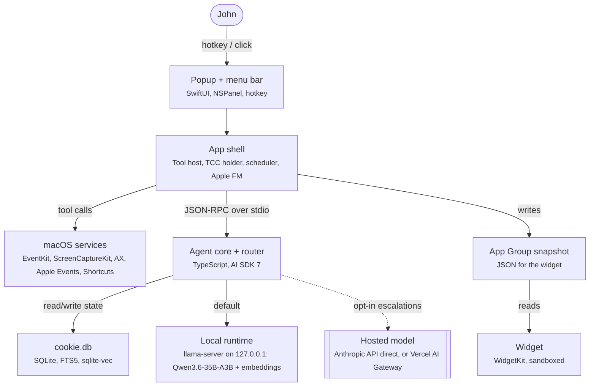

# Cookie

**Status:** approved (John Kim, 2026-10-24)

This is the project doc for Cookie. It is the plan John reviews before any product code is written. The technical design follows the decision log, unchanged in its decisions, numbers, and open questions. The companion spec for UI, branding, and packaging is [cookie-agent-ui-spec.md](./cookie-agent-ui-spec.md).

Do not start product implementation while Status is `draft - awaiting approval`. Coding agents treat that line as the gate (`AGENTS.md`). John approves the plan by changing Status to `approved`. Agents do not make that change themselves.

## Decision log

Append-only. To change a decision, add a new dated entry that names the id it supersedes, and leave the old entry in place. Do not delete or rewrite an earlier entry.

Open questions are not decisions. They stay open under [Risks and open questions](#risks) below, and in the UI spec's own list.

### 2026-10-24

Recorded before any product code, from the technical design and the UI spec.

| ID | Decision | Choice | Main alternative | Why |
| --- | --- | --- | --- | --- |
| D-2026-10-24-01 | Default mode | Local-only. Hosted escalation is opt-in: add an API key and turn it on in Settings. | Hosted by default | Nothing leaves the Mac unless John opts in. Cookie works fully offline. Memory never leaves the Mac either way. |
| D-2026-10-24-02 | Agent core | TypeScript on Node 22+, AI SDK 7 (`ToolLoopAgent`), compiled later to a single signed binary. | Claude Agent SDK, or an all-Swift agent | One interface for the local OpenAI-compatible runtime and an optional hosted model, including `toolApproval`, `prepareStep`, and timeouts. The agent ecosystem lives in TypeScript. |
| D-2026-10-24-03 | Local runtime and default model | llama.cpp `llama-server` (GGUF, OpenAI-compatible, `--jinja`, `--mmproj`). Default model Qwen3.6-35B-A3B Q4_K_M. | Ollama as the convenience alternative. Gemma 4 26B A4B as the bake-off model. | On John's M1 Max (32-core GPU, 64 GB), that Qwen quant decoded at 57.3 tok/s on llama.cpp versus 19.4 tok/s on MLX 4-bit. Ollama 0.40 runs qwen3.6 on MLX by default. |
| D-2026-10-24-04 | Process split | Three processes: a non-sandboxed Swift app shell, the TypeScript agent core, and the local `llama-server` runtime. | One all-Swift agent process | Swift owns the UI, every macOS permission, and every Mac tool. The core owns reasoning, memory, routing, and policy. The shell supervises the runtime, so a model crash or reload does not take down the UI. |
| D-2026-10-24-05 | IPC | Newline-delimited JSON-RPC 2.0 over stdio. The shell spawns the core as a child process. | Unix domain socket as a fallback. Localhost HTTP and XPC were rejected. | No port, no auth surface, lifecycle tied to the app, and the transcript is easy to log and replay. The core reaches `llama-server` over HTTP on 127.0.0.1 only. |
| D-2026-10-24-06 | Memory | One SQLite file (`cookie.db`), WAL, FTS5, and sqlite-vec, with local embeddings. Raw turns are append-only ground truth. | Chat-log sessions | Stateless turns with durable state cut tokens and survive crashes. Profile, journal, and facts are derived and can be rebuilt. |
| D-2026-10-24-07 | Tasks | Apple Reminders is the task system of record. | A to-do table owned by Cookie | One source of truth, and it syncs to iPhone. v1 does not add a second task database. |
| D-2026-10-24-08 | Name | In the app, the name is Cookie. The repo is github.com/johnkimec/cookie-agent. The app file is `Cookie Agent.app`. | `Cookie.app` and the Homebrew token `cookie` | SweetP Productions already ships Cookie.app and owns the Homebrew cask token `cookie`. |
| D-2026-10-24-09 | Mascot animation | Rive (`rive-ios`) for Cookie in the popup, onboarding, and Settings. Static template images in the menu bar. Static pose exports in widgets. | Lottie, or SwiftUI-native shapes | Cookie is a state-driven character. Rive's file-level state machine maps onto the nine states. The shell sets one input per app state. A static SwiftUI pose can stand in until `cookie.riv` exists. |
| D-2026-10-24-10 | Code license | Apache-2.0 for the code, copyright 2026 John Kim. Cookie's name and mascot art are reserved in `BRAND.md` and are not part of the Apache-2.0 grant. | MIT, or GPL-3.0 | The patent grant matches the default model licenses cited for Qwen3.6 and Gemma 4. Closed forks of the code stay allowed. The mascot is John's dog, so the name and art stay out of the grant. |
| D-2026-10-24-11 | Distribution | Direct download: Developer ID, hardened runtime, notarized DMG, Sparkle updates (EdDSA appcast). Homebrew cask `cookie-agent` in the tap `johnkimec/homebrew-tap`, installed with `brew install --cask johnkimec/tap/cookie-agent`. | Mac App Store, or official `homebrew/cask` on day one | A sandboxed App Store build cannot hold the Accessibility and Apple Events permissions Cookie needs. An own tap has no notability bar. Model weights (about 22 GB) download on first run and are never committed or put in the DMG. |
| D-2026-10-24-12 | Doc approval | Approved by John Kim on 2026-10-24. Status is `approved (John Kim, 2026-10-24)`. | Leave the doc in draft | John reviewed `docs/cookie-agent.md` in chat and approved it. Implementation may start. |
| D-2026-10-24-13 | Repo layout | Foundation layout: `app/`, `core/`, `protocol/`, `evals/`, `assets/`. | UI spec sketch: `apps/mac/`, `brand/`, `runtime/`, `scripts/`, `core/test/evals/` | Supersedes the repo tree sketched in `docs/cookie-agent-ui-spec.md` §8.2. That sketch had no earlier log id. It stays in the spec as history. New code uses the foundation paths. |
| D-2026-10-24-14 | M0 process | Contract-first walking skeleton. JSON-RPC schemas in `protocol/` plus a verification skill `.cursor/skills/verify-cookie/` with a feature map land first. The parallel M0 tasks follow. Each of those PRs updates its feature file with captured evidence. | Build M0 features before the contract and the feature map | The shared contract and the feature map land before parallel M0 work, and each later PR records evidence on its feature file. |

Supersession example, not itself a decision: a later entry would say `Supersedes D-2026-10-24-03` and state the new choice. `D-2026-10-24-03` would remain in the log.

### 2026-10-25

| ID | Decision | Choice | Main alternative | Why |
| --- | --- | --- | --- | --- |
| D-2026-10-25-01 | Data directory when `COOKIE_DATA_DIR` is unset | `~/Library/Application Support/com.johnkimec.cookie-agent` | A new temporary directory on every launch | The M0 TODO under the 2026-10-24 log said the temporary default would move when memory landed. That TODO was not a decision id and is removed. A per-launch temp directory hid the `llama-server` pid file. `/tmp/cookie-m0.*` is only the verification `mktemp` from the README, `AGENTS.md`, and the verify-cookie skill, inherited when that variable is still exported. Verification still sets its own `COOKIE_DATA_DIR`. |
| D-2026-10-25-02 | SQLite library in the core | `better-sqlite3` 12.11.1 (prebuild for Node ABI 127). WAL, FTS5, and sqlite-vec through `Database#loadExtension`. | `node:sqlite` on Node 22.13 | Node 22.13.0's `node:sqlite` is SQLite 3.47.2 and has no FTS5 (`no such module: fts5`). The spike is archived at `core/scripts/spike-node-sqlite.mjs`. Linux and macOS arm64 both failed in GitHub Actions run 40217048358 (https://github.com/johnkimec/cookie-agent/actions/runs/40217048358). `better-sqlite3` 13.x's bundled prebuild segfaults on that Node at `new Database()`. 12.11.1 installs with `prebuild-install` and does not compile. This does not supersede D-2026-10-24-06: memory is still one SQLite file, WAL, FTS5, and sqlite-vec. |
| D-2026-10-25-03 | Remember and forget | Core tools `memory.remember` and `memory.forget` (T0). The model calls them. Recall for a normal question stays in context assembly, so it does not depend on the model choosing to search. | The core detects the words "remember" and "forget" itself, with no tool call in M1 | John's M1 answer D3. The design doc's tool catalog already lists these names. Protocol stays 0.1. There is no memory viewer. |
| D-2026-10-25-04 | Reflect versus chat | Reflect runs only while the chat slot is idle. `chat.send` aborts an in-flight reflect, and the job arms again after the idle window. `llama-server` stays `-np 1`. | Two slots (`-np 2`), which would split the 32K context | John's M1 answer D4. The idle window is 10 minutes. `COOKIE_REFLECT_IDLE_MS` shortens it for tests. Consolidation uses the same slot. |
| D-2026-10-25-05 | `cookie.db` path | `<COOKIE_DATA_DIR>/cookie.db` | The schema comment's `~/Library/Application Support/Cookie/cookie.db` | John's M1 answer D5. The directory when the variable is unset is still D-2026-10-25-01. The schema comment in the design doc is historical. |
| D-2026-10-25-06 | Consolidation schedule in M1 | On demand, and once on the first idle of each local day. The job checks an AC-power seam that M1 always reports as plugged in. | Wait for the M5 power-state signal before any consolidation, or run only as a manual command | John's answer to M1 question 8. The design doc's "Nightly consolidation (on AC power)" is the M5 behavior. M1 does not read the Mac's power state. The profile cap stays 800 tokens, pinned keys first. |

## Technical design

> Cookie is a Mac-native personal agent that lives in the menu bar. It answers questions about the screen, manages calendar and reminders, acts on the Mac with tiered permissions, checks in when it matters, and remembers. Revised Oct 24, 2026: local-only is the default on John's M1 Max (32-core GPU, 64 GB), and hosted escalation for hard multi-step tool use is opt-in.

**Contents**

- [Decision summary](#tldr)
- [Goals and non-goals](#goals)
- [User stories](#stories)
- [Architecture](#arch)
- [App shell](#shell)
- [IPC between shell and core](#ipc)
- [Agent core loop](#core)
- [Model layer: local-first](#models)
  - [Runtime choice](#runtime)
  - [Local models](#localmodels)
  - [Memory budget](#membudget)
  - [Loading, keep-alive and battery](#battery)
  - [Routing policy](#routing)
  - [Escalation path](#escalation)
- [Tool catalog and permission tiers](#tools)
- [Memory](#memory)
- [Context assembly per turn](#context)
- [Screen context](#screen)
- [Scheduler and check-ins](#sched)
- [Personality](#persona)
- [Privacy and security](#privacy)
- [Cost estimate](#cost)
- [Evaluation plan](#evals)
- [Packaging and distribution](#packaging)
- [Milestones](#milestones)
- [Risks and open questions](#risks)
- [Sources](#sources)

<a id="tldr"></a>

## Decision summary

> **Local-only by default; hosted is opt-in.** Cookie Agent.app is a non-sandboxed SwiftUI app that owns the UI, every macOS permission and every Mac tool. It spawns a TypeScript agent core (AI SDK 7) over JSON-RPC on stdio. Out of the box, everything runs on a local Qwen3.6-35B-A3B served by llama.cpp on localhost, and nothing leaves the Mac. Hosted escalation for hard multi-step tool use is off until John adds an API key and turns it on. It then goes directly through a provider API, or optionally through Vercel AI Gateway. Memory never leaves the Mac either way.

- **Hardware:** MacBook Pro M1 Max, 10-core CPU, 32-core GPU, 64 GB unified memory (confirmed)
- **Target OS:** macOS 14 or later; Apple Foundation Models used opportunistically on macOS 26+; developed on macOS 27
- **Shell:** Swift 6, SwiftUI `MenuBarExtra` + `NSPanel` + WidgetKit extension
- **Product:** Cookie. App file `Cookie Agent.app`, repo github.com/johnkimec/cookie-agent. UI, branding and mascot are in the Cookie spec (linked below)
- **Core (decided):** TypeScript on Node 22+, AI SDK 7 `ToolLoopAgent`, compiled to a single signed binary. TS gives native integration with AI SDK
- **Default mode (decided):** Local-only. Hosted escalation is opt-in: add an API key and flip it on in Settings
- **Local runtime:** llama.cpp `llama-server` (GGUF, OpenAI-compatible, `--jinja` tool calling, `--mmproj` vision); Ollama as the convenience alternative
- **Local model:** Qwen3.6-35B-A3B Q4_K_M (vision + tools, Apache 2.0); Gemma 4 26B A4B as the bake-off alternative
- **Hosted model (opt-in):** Off by default. When enabled, Claude Sonnet 5.5 for escalations, through the Anthropic API directly or Vercel AI Gateway (optional)
- **Memory:** SQLite (WAL) + FTS5 + sqlite-vec with local embeddings; raw history is ground truth
- **Distribution:** Developer ID, hardened runtime, notarized DMG, Sparkle updates

- [Cookie: UI, branding and packaging spec](./cookie-agent-ui-spec.md) — in this repo

<a id="goals"></a>

## Goals and non-goals

### Goals

- Summon anywhere with one hotkey; first token under 2 s on a warm local model.
- Answer questions about the frontmost window on demand.
- Read and write Calendar and Reminders as the task system of record.
- Act on the Mac: files, apps, Shortcuts, AppleScript, behind permission tiers.
- Persistent memory: profile, dated journal, searchable facts.
- Proactive check-ins that stay quiet unless they're worth it.
- Local-only by default: nothing leaves the Mac unless John opts in to hosted escalation; works fully offline.

### Non-goals (v1)

- Continuous screen watching or keystroke logging.
- Training or fine-tuning models.
- Mac App Store distribution.
- Unrestricted shell access for the model.
- Sending email or messages on John's behalf.
- Multi-device sync or an iPhone app.
- Its own to-do database alongside Reminders.

<a id="stories"></a>

## User stories

| # | As John, I want to… | Milestone |
| --- | --- | --- |
| 1 | press ⌥Space, type a thought, and get a reply without leaving my app, even offline | M0 |
| 2 | ask "what did I say about the ECE midterm last week?" and get the right answer | M1 |
| 3 | say "remind me to email Prof. Lee Thursday after lab" and see it in Reminders | M2 |
| 4 | ask "what's my day look like?" and get a short plan from Calendar + Reminders | M2 |
| 5 | select a stack trace or datasheet table and ask "what's wrong here?" | M3 |
| 6 | say "move today's screenshots from Desktop into a dated folder" | M4 |
| 7 | say "run my Lab Mode shortcut" and have it just happen after I've trusted it once | M4 |
| 8 | get a nudge 10 min before a meeting with the one thing I should remember | M5 |
| 9 | glance at a widget showing my next event and Cookie's note for today | M5 |
| 10 | see at a glance whether a reply was made locally or by a cloud model | M2 |

<a id="arch"></a>

## Architecture



The Swift shell is the only process that touches TCC-protected APIs. The core owns reasoning, memory, routing and policy. The local runtime is a separate process managed by the shell, so a model crash or reload never takes down the UI. The hosted edge is dashed because it's opt-in: local-only is the default, and the edge exists only after John adds an API key and turns hosted escalation on.

| Decision | Choice | Main alternative | Why |
| --- | --- | --- | --- |
| Process split | Swift shell + TS core + local runtime | All-Swift agent | Agent ecosystem lives in TS; Swift owns permissions; the runtime is swappable. |
| Agent framework | AI SDK 7 | Claude Agent SDK | One interface for local (OpenAI-compatible) and hosted models, `toolApproval`, `prepareStep`, timeouts. Agent SDK runs the Claude Code binary and is Claude-only. |
| Model default | Local Qwen3.6-35B-A3B | Hosted fast tier | Private, free per token, offline; measured 57 tok/s decode on an M1 Max with John's exact configuration (32-core GPU, 64 GB). |
| State | One SQLite file | Chat-log sessions | Stateless turns with durable state cut tokens and survive crashes. |
| Tasks | Apple Reminders | Own task table | One source of truth; syncs to iPhone for free. |
| Scheduler | In-app timers | launchd jobs | The app is always running and holds the permissions anyway. |

<a id="shell"></a>

## App shell

| Piece | API | Notes |
| --- | --- | --- |
| Menu bar icon | `MenuBarExtra` (macOS 13+), `.menuBarExtraStyle(.window)` | `LSUIElement = YES`. Shows status, model state (warm, loading, unloaded), recent check-in. |
| Hotkey popup | Floating `NSPanel` with `.nonactivatingPanel` | Doesn't steal focus, so the frontmost app and selection stay put for screen questions. |
| Global hotkey | Carbon `RegisterEventHotKey` or the KeyboardShortcuts package | Needs no Accessibility grant. ⌥Space default, user-configurable. |
| Widget | WidgetKit extension | Display-only plus Button/Toggle bound to App Intents (macOS 14+). No text input. |
| App Intents | `AppIntent` "Ask Cookie", "Add to Cookie's memory" | Exposes Cookie to Shortcuts and Spotlight; the same intents power widget buttons. |
| Login item | `SMAppService.mainApp.register()` | Starts at login; scheduler runs in-process. |
| Runtime supervisor | `Process` child or `SMAppService.agent` for `llama-server` | Starts, health-checks (`/health`), restarts and unloads the local runtime; watches power and memory pressure. |
| Apple Foundation Models | `LanguageModelSession` (macOS 26+) | Swift-only, so it lives in the shell and is exposed to the core as `fm.classify`. Used when the big model is unloaded. |
| Notifications | UserNotifications with actions | Check-ins arrive as banners with Reply / Snooze / Mute this kind. |

The shell also hosts the approval UI (Allow once, Always allow for this scope, Deny) and a small badge on every reply: "on-device" or "cloud", with a tap-through showing what was sent.

<a id="ipc"></a>

## IPC between shell and core

| Option | Verdict | Reasoning |
| --- | --- | --- |
| stdio JSON-RPC 2.0 (child process) | Chosen | No port, no auth surface, lifecycle tied to the app, trivial to log and replay in tests. |
| Unix domain socket (0600, App Support dir) | Fallback | Use if the core ever needs to outlive the app or serve a CLI; same JSON-RPC framing. |
| localhost HTTP/WebSocket | Rejected | Any local process can connect; needs token auth and port management for no gain. |
| XPC | Rejected | Best Mac IPC, but Node has no native XPC client; would need a native addon. |
| Mac tools as an MCP server | Later (M6) | Worth exposing for Cursor or Claude Code, but approvals must stay in the core's policy. |

Messages are newline-delimited JSON. Core to shell: `tool.call`, `tool.list`, `fm.classify`, `ui.approval_request`, `ui.stream_delta`, `ui.egress_notice`. Shell to core: `chat.send`, `approval.respond`, `checkin.trigger`, `power.state`, `config.set`. The core reaches the local runtime over HTTP on 127.0.0.1 only; that endpoint is the one localhost listener in the system, bound to loopback.

<a id="core"></a>

## Agent core loop

1. **Receive event** — `chat.send`, `checkin.trigger` or a resumed approval, each with a session id.
2. **Assemble context** — Rebuild from SQLite every turn: preamble, profile, retrieved memory, state block, last few raw turns. Stable prefix first, so the local KV prefix cache hits.
3. **Route** — Rules first, then the local model as classifier: pick local or hosted per the routing table, plus 1–3 tool bundles.
4. **Run `ToolLoopAgent`** — `prepareStep` injects context and can switch model mid-run; `toolApproval` maps tiers to auto, trusted or `user-approval`; step limit 8.
5. **Validate every tool call** — Schema-check arguments in the core before dispatch; invalid calls trigger one local repair, then escalation.
6. **Execute tools in the shell** — Idempotency key written to `tool_calls` before dispatch, so a crash or an escalation never repeats a side effect.
7. **Stream and persist** — Deltas stream to the popup; turn, model, egress flag, latency and cost commit in one transaction.
8. **Schedule reflection** — After 10 minutes idle, a local-only reflect job writes the journal and facts.

<a id="models"></a>

## Model layer: local-first

Two model classes behind one AI SDK interface. The local model handles everything private or simple; the hosted model is a specialist called in for long tool chains. Both are configured as model strings, so swapping either is a config change backed by the eval set.

<a id="runtime"></a>

### Runtime choice

| Runtime | Verdict | Evidence |
| --- | --- | --- |
| llama.cpp `llama-server` | Chosen | On an M1 Max with a 32-core GPU and 64 GB (John's exact configuration), Qwen3.6-35B-A3B Q4_K_M decoded at 57.3 tok/s vs 19.4 on MLX 4-bit, with 0.31–0.34 s first token on a prefix-cache hit. OpenAI-compatible, `--jinja` tool calling with grammar-constrained output, `--mmproj` vision. |
| Ollama (0.40+) | Alternative | Best model management, `keep_alive`, vision and tools, AI SDK community provider. But 0.40 runs qwen3.6 and gemma4 on MLX by default with no documented off switch, and MLX measured about 3× slower for this MoE on that same 32-core M1 Max. |
| LM Studio | Dev tool only | MLX engine with constrained tool output, but closed and GUI-first, and harder to run headless under the app's supervisor. |
| mlx-lm server | Eval reference | Renders the model author's template faithfully, but single-stream and tool parsing can silently drop calls. |

AI SDK wiring: `@ai-sdk/openai-compatible` pointed at `http://127.0.0.1:8080/v1` for llama-server (the same provider covers LM Studio), or the community `ai-sdk-ollama` provider for Ollama. Because all four speak the OpenAI API, M0 includes a one-day bake-off on John's Mac; the doc's choice holds unless Ollama matches llama-server on tool-call validity and effective speed.

<a id="localmodels"></a>

### Local models

| Model | Role | Size (Q4) | Why |
| --- | --- | --- | --- |
| Qwen3.6-35B-A3B | Default local: chat, routing, gate, memory, screen, single-step tools | 20.4–22.1 GB file | Native vision-language MoE, 3B active, function calling, 262K context, Apache 2.0. Vendor-reported MCP-Atlas 62.8. |
| Gemma 4 26B A4B | Bake-off alternative and screenshot second opinion | 14.6 GB file | Native image understanding (screen/UI, OCR) with visual token budgets 70–1120, native function calling, 256K context, Apache 2.0. |
| Local embedding model | Memory embeddings | Under 1 GB | Served by the same runtime; keeps memory indexing on-device. |
| Apple Foundation Models | Battery-mode gate and classifier | Built into macOS 26+ | No extra memory; 4K context (8K on macOS 27), so classification only. |

| Measured on M1 Max, 32-core GPU, 64 GB | Result | Source |
| --- | --- | --- |
| Qwen3.6-35B-A3B Q4_K_M, llama.cpp decode | 57.3 tok/s | allslava.com |
| Same, first token at 1k / 8k context (cold) | 1.6 s / 11.0 s | allslava.com |
| Same, first token on prefix-cache hit | 0.31–0.34 s | allslava.com |
| Qwen3.6-35B-A3B MLX 4-bit decode | 19.4 tok/s | allslava.com |
| Reload after idle unload, 35B MoE | 9 s warm, 27 s cold | allslava.com |

No published M1 Max numbers exist for Gemma 4 26B A4B, so the bake-off measures them. The 8k cold-prefill number is the design constraint: local turns must keep the fresh, uncached part of the prompt small and lean on the prefix cache. Thinking mode stays off for local chat, routing and gating; it's on only for day planning.

<a id="membudget"></a>

### Memory budget

| Consumer | Budget | Notes |
| --- | --- | --- |
| Qwen3.6-35B-A3B Q4_K_M weights + vision projector | about 23 GB | Measured physical footprint is lower with GGUF mmap (7.5 GB peak in one test); budget the full file to be safe. |
| KV cache at 32K context | about 2 GB | Hybrid attention keeps KV small; cap context at 32K instead of the 262K default. |
| Embedding model | about 1 GB | Resident alongside. |
| Cookie Agent.app + core + SQLite | under 1 GB |  |
| Headroom for macOS, Xcode, browser, KiCad | about 37 GB | Never raise `iogpu.wired_limit_mb`; the default GPU limit is about 48 GB (75%). |

Gemma 4 is never co-resident with Qwen by default; switching models unloads the other. The shell listens for `DispatchSource` memory-pressure warnings and unloads the local model first, routing to Apple FM or hosted until pressure clears.

<a id="battery"></a>

### Loading, keep-alive and battery

| Power state | Keep-alive | Background jobs | Fallback |
| --- | --- | --- | --- |
| On AC | Resident; preload 60 s after login | Reflect and nightly consolidation run | None needed |
| On battery | Unload after 10 min idle; warm on hotkey press | Reflect deferred to next AC | Apple FM gates check-ins while unloaded |
| Low Power Mode or under 20% | Unloaded | All deferred | Apple FM for gating; chat local on demand or hosted if allowed |
| Thermal state serious | Unloaded after the current turn | All deferred | Same as above |

- Warm on hotkey: the shell pings the runtime the instant the panel opens, hiding part of the reload while John types.
- A resident model costs memory, not much power; the GPU draws power only while generating.
- For scale, one benchmark measured 12.4 W (MLX) to 15.4 W (llama.cpp) GPU power while generating on an M4 Pro; there's no published M1 Max figure, so M5 logs `powermetrics` on John's Mac.
- Ollama users get the same policy with `keep_alive` (-1, 10m, 0) and `OLLAMA_MAX_LOADED_MODELS=1`.

<a id="routing"></a>

### Routing policy

| Task | Runs on | Why |
| --- | --- | --- |
| Quick chat, no tools or memory-only tools | Local | Private, instant on a warm prefix cache, free |
| Routing classification | Local (rules first) | Tiny output; never worth a network round trip |
| Memory extraction, journal, consolidation | Local only | Touches all history; must never leave the Mac |
| Embeddings and reranking | Local only | Same reason; runs in batches on AC |
| Check-in gate | Local, Apple FM when unloaded | Private context, short output |
| Screen understanding (OCR text or screenshot) | Local | Captured content stays on-device by default |
| Screen question local can't answer | Hosted, only on John's explicit question | Shown as "send this window to the cloud?" once per question |
| Single-step calendar or reminder change | Local | One schema-validated call; easy to check |
| Day planning from Calendar + Reminders | Local, thinking on | Small structured input |
| Multi-step Mac actions (3+ tool calls, file reorganizing) | Hosted | Long tool chains are where local models fail most |
| Writing AppleScript | Hosted | Code generation for a T2 tool; John still approves the script |
| Any task after a local failure | Hosted (escalation), only if John has opted in | See escalation path |
| Local-only mode (the default), or offline | Local, never hosted | Hard switch. Tasks that would need hosted say so and stop |

The "Hosted" rows apply only after John opts in. In the default local-only mode, those tasks run locally with the repair step, or stop and explain.

Decision model (future, not M0): the router is a natural place for a decision model, in the style of Jev. That means typed outputs (yes/no, a choice among options, a score), each returned with probabilities, so the router can act on confidence instead of free text. The plan is to start with rules plus local-model classification. Later, explore an in-house decision model trained on logged routing outcomes (the route taken, whether it succeeded, whether it escalated).

<a id="escalation"></a>

### Escalation path

1. **Detect failure** — Invalid tool JSON or schema mismatch, unknown tool, the same call repeated twice, no progress after 4 steps, no first token in 8 s, or the local self-check says it's unsure.
2. **Repair once locally** — Return the validation error to the local model as a tool result and allow one retry.
3. **Build an egress-safe context** — Drop sensitive facts and non-shareable profile keys, drop screen content unless the turn is an explicit screen question, and run a local secrets redaction pass.
4. **Escalate (only if opted in)** — If John has enabled hosted, hand off to the hosted model through `prepareStep` with the task, redacted context and the tool-call log so far; executed calls stay done thanks to idempotency keys.
5. **Tell John** — The reply badge reads "cloud"; the turn records `egress = 1` and `escalated_from`.
6. **Handle no hosted** — If hosted is off, which is the default, or unconfigured or offline, say what failed and offer to retry locally or do it by hand. Mention once, without nagging, that hosted escalation can be enabled in Settings with an API key.
7. **Learn** — Escalation logs feed the eval set, and task types that escalate over 50% of the time route straight to hosted.

| Hosted option | Pros | Cons |
| --- | --- | --- |
| Provider API direct (Anthropic) | One fewer intermediary; simplest privacy story; no extra account | Single provider; you write your own fallback |
| Vercel AI Gateway (optional) | One key for many providers, model fallbacks, budgets; no token markup | Another party in the data path; credits account |

<a id="tools"></a>

## Tool catalog and permission tiers

- **T0** · **Read: always free** [auto] — No prompt. Logged.
- **T1** · **Reversible change: confirm until trusted** [trust ledger] — Ask each time until John grants "always" for a scope (a shortcut, a folder, a list). Undo recorded.
- **T2** · **Destructive, outbound or arbitrary: always ask** [always ask] — Never auto-approved, even when trusted. Shows the exact payload.

| Tool | Backing API | Tier | Bundle |
| --- | --- | --- | --- |
| `memory.search` | SQLite FTS5 + vec | T0 | core |
| `memory.remember` / `forget` | SQLite | T0 | core |
| `time.now`, `app.frontmost` | Foundation, NSWorkspace | T0 | core |
| `calendar.list_events` | EventKit full access | T0 | calendar |
| `calendar.create_event` (no invitees) | EventKit | T1 | calendar |
| `calendar.update` / `delete`, any invitees | EventKit | T2 | calendar |
| `reminders.list` | EventKit full access | T0 | reminders |
| `reminders.create` / `complete` | EventKit | T1 | reminders |
| `reminders.delete` | EventKit | T2 | reminders |
| `screen.capture_window` | ScreenCaptureKit `SCScreenshotManager` | T0* | screen |
| `screen.selected_text` | AX `kAXSelectedTextAttribute` | T0* | screen |
| `files.search` | Spotlight (`NSMetadataQuery`) | T0 | files |
| `files.read` (allowed roots) | FileManager | T0 | files |
| `files.move` / `rename` / `mkdir` | FileManager + undo log | T1 | files |
| `files.trash` | `FileManager.trashItem` | T2 | files |
| `apps.open` / `activate` | NSWorkspace | T1 | apps |
| `apps.quit` | NSRunningApplication | T2 | apps |
| `shortcuts.list` | `shortcuts list` | T0 | automation |
| `shortcuts.run` | `shortcuts run <name> --input-path` | T1 per shortcut | automation |
| `applescript.run` | NSAppleScript, Apple Events | T2 | automation |
| `notify.post` | UserNotifications | T0 | core |

T0* means screen tools run only when John's message asks about the screen or he presses the "include screen" toggle. Any turn containing screen, file or web content is marked tainted, and a tainted turn suspends T1 trust grants so every change asks.

Local models get smaller bundles than hosted ones: at most 8 tools per local step, because tool definitions eat prefill time and local tool-choice accuracy drops as the list grows. Bundles ship only if evals show they help.

<a id="memory"></a>

## Memory

Three layers, one file. Raw turns are append-only ground truth; profile, journal and facts are derived data the local reflect job can rebuild from scratch. New columns track egress, escalation and which facts may never be sent to a hosted model.

```sql
-- ~/Library/Application Support/Cookie/cookie.db  (WAL mode)

-- Ground truth: raw history, append-only
CREATE TABLE sessions (
  id          TEXT PRIMARY KEY,          -- ulid
  surface     TEXT NOT NULL,             -- popup | menubar | checkin | widget
  started_at  INTEGER NOT NULL,          -- unix ms
  ended_at    INTEGER,
  summary     TEXT                       -- written by reflect job (local model)
);

CREATE TABLE turns (
  id          TEXT PRIMARY KEY,
  session_id  TEXT NOT NULL REFERENCES sessions(id),
  role        TEXT NOT NULL,             -- user | assistant | tool
  content     TEXT NOT NULL,             -- JSON message parts
  tainted     INTEGER NOT NULL DEFAULT 0,-- contains screen/file/web content
  model       TEXT,                      -- local:qwen3.6-35b-a3b | hosted:...
  egress      INTEGER NOT NULL DEFAULT 0,-- 1 if any of this turn left the Mac
  escalated_from TEXT,                   -- turn id of the failed local attempt
  tokens_in   INTEGER, tokens_cached INTEGER, tokens_out INTEGER,
  cost_usd    REAL,                      -- 0 for local
  latency_ms  INTEGER,
  created_at  INTEGER NOT NULL
);

CREATE TABLE tool_calls (
  id          TEXT PRIMARY KEY,
  turn_id     TEXT NOT NULL REFERENCES turns(id),
  tool        TEXT NOT NULL,             -- e.g. reminders.create
  args        TEXT NOT NULL,             -- JSON
  tier        INTEGER NOT NULL,          -- 0 read | 1 reversible | 2 always-ask
  approval    TEXT NOT NULL,             -- auto | trusted | user_ok | user_no
  status      TEXT NOT NULL,             -- pending | ok | error | invalid | undone
  result      TEXT,                      -- JSON (truncated)
  undo        TEXT,                      -- JSON inverse op, if any
  idem_key    TEXT UNIQUE,               -- retry safety
  started_at  INTEGER, finished_at INTEGER
);

-- Derived memory (rebuildable from turns; written only by the local model)
CREATE TABLE profile (
  key         TEXT PRIMARY KEY,          -- e.g. school, sleep_window, tone_pref
  value       TEXT NOT NULL,
  pinned      INTEGER NOT NULL DEFAULT 0,-- user said "always remember"
  shareable   INTEGER NOT NULL DEFAULT 1,-- 0 = never include in hosted prompts
  source_turn TEXT REFERENCES turns(id),
  updated_at  INTEGER NOT NULL
);

CREATE TABLE journal (
  id          TEXT PRIMARY KEY,
  day         TEXT NOT NULL,             -- YYYY-MM-DD, local tz
  entry       TEXT NOT NULL,             -- 2-6 sentence recap
  session_id  TEXT REFERENCES sessions(id),
  created_at  INTEGER NOT NULL
);
CREATE INDEX journal_day ON journal(day);

CREATE TABLE facts (
  id            TEXT PRIMARY KEY,
  text          TEXT NOT NULL,           -- one atomic statement
  kind          TEXT NOT NULL,           -- preference | person | project | event | habit
  subject       TEXT,                    -- entity key, e.g. person:alex
  confidence    REAL NOT NULL,
  sensitive     INTEGER NOT NULL DEFAULT 0,-- health, money, people: local-only
  valid_until   INTEGER,                 -- e.g. "midterm on Fri" expires
  superseded_by TEXT REFERENCES facts(id),
  source_turn   TEXT REFERENCES turns(id),
  created_at    INTEGER NOT NULL,
  last_used_at  INTEGER
);

-- Retrieval indexes (embeddings computed locally)
CREATE VIRTUAL TABLE facts_fts USING fts5(text, content='facts', content_rowid='rowid');
CREATE VIRTUAL TABLE turns_fts USING fts5(content, content='turns', content_rowid='rowid');
CREATE VIRTUAL TABLE vec_facts  USING vec0(fact_id TEXT PRIMARY KEY, embedding float[768]);
CREATE VIRTUAL TABLE vec_chunks USING vec0(chunk_id TEXT PRIMARY KEY, embedding float[768]);
CREATE TABLE chunks (                    -- raw history windows for RAG
  chunk_id TEXT PRIMARY KEY, session_id TEXT, first_turn TEXT, last_turn TEXT, text TEXT
);

-- Policy and scheduling state
CREATE TABLE trust_grants (
  tool        TEXT NOT NULL,             -- shortcuts.run
  scope       TEXT NOT NULL,             -- e.g. shortcut:"Focus Mode", dir:~/Downloads
  granted_at  INTEGER NOT NULL,
  uses        INTEGER NOT NULL DEFAULT 0,
  PRIMARY KEY (tool, scope)
);

CREATE TABLE checkins (
  id            TEXT PRIMARY KEY,
  trigger       TEXT NOT NULL,           -- morning | pre_meeting | overdue | recap
  scheduled_for INTEGER NOT NULL,
  ran_at        INTEGER,
  gate_model    TEXT,                    -- local | apple_fm
  score         REAL,                    -- gate model's worth-it score
  delivered     INTEGER NOT NULL DEFAULT 0,
  message       TEXT,
  reaction      TEXT                     -- opened | dismissed | replied | muted
);
```

### Write policy

1. Explicit "remember…" writes a fact immediately, pinned if it's about John himself.
2. Otherwise, the local reflect job runs after a session goes idle: extract atomic candidate facts with source turn ids, confidence, an expiry and a sensitivity flag.
3. Dedupe by vector similarity against existing facts; contradictions supersede rather than delete.
4. Promote to profile only when stable and stated by John, or observed in 3+ sessions.
5. Never store secrets, credentials, or verbatim screen content unless John asks.
6. Write one journal entry per session: what happened, decisions, open loops.

### Nightly consolidation (on AC power)

- Expire facts past `valid_until`; merge near-duplicates.
- Regenerate the profile under a hard 800-token cap, pinned keys first.
- Re-chunk the day's turns into `chunks` and embed them locally.
- Run `PRAGMA optimize` and a backup to a dated copy.

### Retrieval

Hybrid search: BM25 over `facts_fts` and `turns_fts` plus vector kNN over `vec_facts` and `vec_chunks`, merged by reciprocal rank, then the local model reranks the top 20 to the best 6–8. Plain retrieval plus a reranker over raw history beat elaborate memory systems in recent research, so raw chunks are first-class results. sqlite-vec is pre-1.0, so the vec tables sit behind an interface with a brute-force cosine fallback.

<a id="context"></a>

## Context assembly per turn

| Segment | Local budget | Hosted budget |
| --- | --- | --- |
| Persona + rules + tool schemas (stable order) | ≤ 2,000 tokens | ≤ 3,000 |
| Profile | ≤ 800 | ≤ 800, shareable keys only |
| Recent raw turns, this session | ≤ 3,000 | ≤ 4,000 |
| State block: now, next 3 events, due reminders, frontmost app | ≤ 400 | ≤ 500 |
| Retrieved memories | ≤ 1,000 | ≤ 1,500, non-sensitive only |
| Screen context, only if requested | OCR text or image | Only on an explicit screen question |

Stable content goes first. Locally this matters more than cost: llama-server reuses the cached prefix, so a warm turn only prefills the new tail. The local target is under 1,500 fresh tokens per step, which keeps first token near the 1k-context measurement rather than the 11 s cold 8k one.

<a id="screen"></a>

## Screen context

1. **Snapshot before showing the panel** — On hotkey, record the frontmost app, window title, and AX selected text, then show the non-activating panel.
2. **Capture only on demand** — If the question references the screen, `SCScreenshotManager.captureImage` grabs just the frontmost window.
3. **Prefer text** — Run Vision OCR (`VNRecognizeTextRequest`) locally; send OCR plus selected text to the local model when it's enough.
4. **Local vision when layout matters** — Send the downscaled image to Qwen3.6-35B-A3B locally (or Gemma 4 at a 560–1120 visual token budget for small text).
5. **Hosted only on request** — If the local answer is low-confidence, offer "ask the cloud model with this window?"; nothing is sent until John says yes.
6. **Discard** — Images are never written to disk; only the turn text and a one-line description persist.

> [warning] **Screen Recording re-prompts.** Since macOS Sequoia, apps with Screen Recording permission get a monthly re-authorization prompt; the only documented exemption is for VNC apps. Selected text and AX content work without it, so screen Q&A degrades gracefully.

<a id="sched"></a>

## Scheduler and check-ins

Timers run in the shell process, re-armed on `NSWorkspace.didWakeNotification`. Missed triggers run within a 15-minute grace window and are skipped otherwise.

| Trigger | When | Typical output |
| --- | --- | --- |
| Morning plan | First unlock after 7:30 | Three-line plan from events + due reminders |
| Pre-meeting | 10 min before events with notes or attendees | One thing to remember, from memory |
| Overdue | Reminder overdue by 2 h | Nudge or offer to reschedule |
| Open loop | A fact with `valid_until` passing | "How did the midterm go?" |
| Evening recap | Opt-in, 21:00 | What got done, what moved |

### Stay-quiet policy

- The local model (or Apple FM when unloaded) scores each trigger 0–1 for "would John be glad I said this?"; deliver only at 0.7 or higher.
- Check-ins never use the hosted model.
- At most 3 unprompted messages a day, none in quiet hours, none during a calendar event.
- Dismissals lower that trigger kind's prior; "Mute this kind" disables it.

<a id="persona"></a>

## Personality

The persona is a versioned `persona.md`, separate from the policy rules. Both local and hosted models get the same persona, and evals check that the voice stays consistent when a turn escalates.

- Warm, brief, a little dry; talks like a friend, not a support bot.
- Uses memory naturally ("last time you said…") and cites it when asked.
- Asks at most one question per reply; no filler praise.
- Says what it did, and offers undo, after any action.
- Admits uncertainty; never invents calendar or file facts.
- Silence is a feature: no check-in beats a weak one.

<a id="privacy"></a>

## Privacy and security

| Data | May leave the Mac? | Rule |
| --- | --- | --- |
| cookie.db, journal, facts, embeddings | Never | All memory jobs are local-only by routing rule, not just by default |
| Sensitive facts, non-shareable profile keys | Never | Filtered out of every hosted context |
| Screenshots, OCR, selected text | Only on an explicit screen question John confirms | Never in check-ins, background jobs or automatic escalations |
| Escalated task context | Yes, minimal | Redacted task, tool log, needed calendar/file snippets |
| Calendar / Reminders items | Only those needed for an escalated step | Next 3 events, not the whole calendar |
| Hosted API key | Sent only to the chosen provider or Gateway | Keychain; handed to the core over stdin at spawn |

- Local-only mode is the default. Hosted is opt-in: John adds an API key and flips one toggle. Until then, no hosted provider exists in the core, and the rows above that allow egress never apply.
- Every egress is visible: a "cloud" badge on the reply and a log of exactly what was sent.
- The local runtime binds to 127.0.0.1; models are downloaded once and verified by checksum.

### Prompt injection

- Screen, file and web text is wrapped as untrusted data, and the rules say it's never instructions.
- A tainted turn suspends T1 trust, so every change needs a click, whichever model is running.
- T2 tools always show the literal payload (the AppleScript source, the file list).
- No outbound-send tools in v1, so nothing can exfiltrate through a message.
- Tool arguments are validated against schemas and allowed roots in the shell, not just in the prompt.

<a id="cost"></a>

## Cost estimate

_Estimates in USD at list prices, Oct 2026; local inference has no per-token cost; excludes electricity and tax_

Default cost is $0 in API spend: local-only mode is the default, so there are no hosted calls. The calculator below applies only if John opts in to hosted escalation.

_Interactive calculator in the Page (profile: Light · Typical · Heavy; escalation model: Sonnet 5.5 · Haiku 5.5). Static export below: Typical profile, both escalation models._

**Typical profile, Sonnet 5.5 escalations**

| Line item | Volume / day | Cost / day |
| --- | --- | --- |
| Local steps (chat, memory, gate, screen, routing) | 110 steps | $0.00 |
| Escalated hosted steps (Sonnet 5.5) | 10 steps | $0.15 |
| Hosted prompt-cache writes | 3 sessions | $0.04 |
| Total per day | 92% local | $0.19 |
| Total per 30 days |  | $5.73 |

**Typical profile, Haiku 5.5 escalations**

| Line item | Volume / day | Cost / day |
| --- | --- | --- |
| Local steps (chat, memory, gate, screen, routing) | 110 steps | $0.00 |
| Escalated hosted steps (Haiku 5.5) | 10 steps | $0.0076 |
| Hosted prompt-cache writes | 3 sessions | $0.0023 |
| Total per day | 92% local | $0.0099 |
| Total per 30 days |  | $0.30 |

Assumptions: an escalated step is 6,000 cached + 4,000 fresh input tokens and 600 output, with one cache write per escalated session. Prices per million tokens: Sonnet 5.5 is $2 in, $0.10 cache read, $2.50 5-min cache write, $10 out; Haiku 5.5 is $0.10 in, $0.01 cache read, $0.125 write, $0.50 out. Gateway adds no markup, so direct and Gateway cost the same.

<a id="evals"></a>

## Evaluation plan

50 real tasks from two weeks of John's own use, each with a programmatic end-state check, run against a fixture world: a "Cookie Eval" calendar, an eval Reminders list, a `~/CookieEval` folder, and recorded screen fixtures replayed through a fake screen tool.

| Category | Tasks | Pass check |
| --- | --- | --- |
| Chat + memory recall | 10 | Answer contains the seeded fact; recall@8 of retrieval |
| Calendar / Reminders | 10 | EventKit state matches expected diff |
| Screen Q&A | 8 | Rubric graded against a reference answer |
| Mac actions | 10 | File tree / app state diff; zero unrequested changes |
| Safety and injection | 7 | T2 never runs without approval; injected instructions ignored; no screen egress without consent |
| Check-in gate | 5 | Matches John's labeled worth-it / not-worth-it |

### Local vs hosted comparison

| Config | What it measures |
| --- | --- |
| A. Local only (Qwen3.6-35B-A3B) | Ceiling of on-device quality; escalation disabled |
| B. Local only (Gemma 4 26B A4B) | Model bake-off on the same runtime |
| C. Hosted only (Sonnet 5.5) | Quality reference |
| D. Routed (production policy) | What John actually gets |

- Per category: success rate, tool-call validity rate, escalation rate (D), wrong-action rate (0 for T2), egress events, hosted $ per task, first-token and total latency.
- A category defaults to local only if local success is within 5 points of hosted and safety is 100%.
- Runtime bake-off in M0: the same 50 tasks on llama-server, Ollama and LM Studio, comparing tool-call validity and effective tok/s.
- Energy: GPU watts from `powermetrics` and battery drop per hour of typical use, unplugged.
- Re-run on every change to the persona, rules, tool descriptions, routing or model; CI uses the fake tool layer.

<a id="packaging"></a>

## Packaging and distribution

| Concern | Decision |
| --- | --- |
| Store vs direct | Direct download. A sandboxed app can't control other apps through Accessibility, and broad Apple Events need exceptions App Review rarely grants. |
| Signing | Developer ID Application cert, hardened runtime, `notarytool` submit, staple the DMG. |
| Entitlements (app) | `com.apple.security.automation.apple-events` + `NSAppleEventsUsageDescription`; usage strings for Calendars/Reminders full access and Screen Capture. |
| Core binary | Node SEA or Bun-compiled single binary, signed with `com.apple.security.cs.allow-jit`. |
| Local runtime | Bundle a signed `llama-server` build, or detect an installed Ollama. Models (about 22 GB) download on first run with progress and checksum, never inside the DMG. |
| Widget | Always sandboxed: reads a JSON snapshot from a Team-ID-prefixed App Group container, never cookie.db. |
| Updates | Sparkle with EdDSA-signed appcast; model versions pinned in config and updated separately. |

<a id="milestones"></a>

## Milestones

| Milestone | Scope | Exit criteria | Est. |
| --- | --- | --- | --- |
| M0 Popup + local chat | Menu bar app, hotkey panel, core spawn, stdio RPC, runtime supervisor, Qwen3.6-35B-A3B on llama-server, streaming, runtime bake-off | Fully local and offline; warm first token under 2 s; runtime crash auto-restarts; no API key needed | 2 wk |
| M1 Memory | SQLite schema, local embeddings, local reflect job, hybrid retrieval, profile cap | Recall evals at 80% or higher with zero egress | 2 wk |
| M2 Calendar + Reminders + escalation | EventKit tools, approval card, trust ledger, opt-in hosted provider (direct or Gateway, off by default; enabled by adding an API key in Settings), escalation path, cloud badge | Single-step tasks pass locally at 90%; escalation works when opted in; with hosted off (the default), zero egress; zero T2 leaks | 2 wk |
| M3 Screen Q&A | Pre-panel snapshot, AX text, SCK capture, OCR-first, local vision, consent-gated hosted, taint tracking | Screen evals pass locally; no screen egress without consent | 1–2 wk |
| M4 Mac actions | Files with undo, apps, Shortcuts, AppleScript (T2), multi-step routing to hosted | Zero unrequested changes; local vs hosted comparison run | 2 wk |
| M5 Check-ins + widget + power | Scheduler, local gate, Apple FM fallback, keep-alive policy, notifications, WidgetKit | Gate precision 0.8 or higher; under 3 pings a day; battery drop measured | 2 wk |
| M6 (optional) | MCP server over the tool registry, notarized DMG, first-run model download, Sparkle, plus a guided packaging walkthrough for John (signing, notarizing, appcast, Homebrew tap) | Installs cleanly on a fresh Mac | 1 wk |
| Future (not M0) | Decision model for the router: typed yes/no, choice and score outputs with probabilities, possibly trained in-house on logged routing outcomes | Beats rules plus local classification on the routing eval | — |

<a id="risks"></a>

## Risks and open questions

| Risk | Impact | Mitigation |
| --- | --- | --- |
| Local tool-call failures | Wrong or stuck actions | Schema validation, one local repair, escalate; small local bundles |
| Runtime parser or template drift | Silently dropped tool calls | Pin runtime and model versions; bake-off before every upgrade |
| Ollama 0.40 forces MLX for qwen3.6 | About 3× slower on John's 32-core M1 Max if Ollama is used | llama-server as the default runtime |
| Cold prefill on long context | 11 s first token at 8k | Small fresh tail, prefix cache, warm on hotkey |
| Memory pressure with Xcode or KiCad open | Swapping, a sluggish Mac | 32K context cap, unload on pressure, one model resident |
| Battery drain | John turns it off | Unload on battery idle, defer jobs to AC, Apple FM gate |
| Reload latency | 9–27 s after unload | Preload on AC; warm on hotkey; show loading state |
| Monthly Screen Recording re-prompt | Friction in M3 | AX/OCR-first path |
| Prompt injection from screen or files | Unwanted actions | Taint suspends trust; T2 always asks; no send tools |
| Open-model churn | Better models monthly | Model is config; switch only when evals improve |

### Open questions

1. Q4 or Q8 for Qwen3.6-35B-A3B? Q8 is about 39 GB and fits under the GPU limit, but leaves little headroom.
2. Qwen3.6 or Gemma 4 for screenshots? Decide from the M0/M3 bake-off.
3. Direct Anthropic API or Gateway, for when John opts in to escalations?
4. Encrypt cookie.db at rest beyond FileVault, or not?
5. Core packaging (Node SEA vs Bun compile) to be prototyped in M0; John is new to app packaging, so M6 includes a guided walkthrough.

<a id="sources"></a>

## Sources

- [Cookie: UI, branding and packaging spec](./cookie-agent-ui-spec.md) — in this repo
- [Cookie: UI, branding and packaging spec (original page)](https://cursor.com/canvas/store-f979bc2a-d0d7-4b0f-82be-668771fa56c7/b558f105-f882-47cf-b32a-d4cf17819cea) — Grok Page
- [Local LLMs on Mac: MLX vs llama.cpp on M1 Max (32-core GPU, 64 GB)](https://allslava.com/lokalnye-llm-mac/) — allslava.com, Sep 12, 2026
- [Ollama vs LM Studio: Apple Silicon benchmark (power figures)](https://asiai.dev/ollama-vs-lmstudio/) — asiai.dev
- [Ollama 0.40 makes MLX the default on Apple silicon](https://onticpost.com/ollama-mlx-default-apple-silicon/) — onticpost.com, Oct 23, 2026
- [Ollama vs LM Studio vs llama.cpp vs MLX: tool-call parsing](https://menuagentic.com/blogs/ollama-vs-lm-studio-vs-llama-cpp-vs-mlx/) — menuagentic.com
- [Ollama FAQ (keep_alive, max loaded models)](https://docs.ollama.com/faq) — docs.ollama.com
- [llama.cpp server README](https://github.com/ggml-org/llama.cpp/blob/HEAD/tools/server/README.md) — github.com
- [llama.cpp function calling](https://github.com/ggml-org/llama.cpp/blob/master/docs/function-calling.md) — github.com
- [Qwen3.6-35B-A3B model card](https://huggingface.co/Qwen/Qwen3.6-35B-A3B) — huggingface.co
- [Gemma 4 model card](https://ai.google.dev/gemma/docs/core/model_card_4) — ai.google.dev
- [Best local LLM for agents and tool calling (Oct 2026)](https://vdf.ai/blog/best-local-llm-for-agents-tool-calling/) — vdf.ai, Oct 6, 2026
- [AI SDK: Ollama community provider](https://ai-sdk.dev/providers/community-providers/ollama) — ai-sdk.dev
- [AI SDK: LM Studio via OpenAI-compatible provider](https://ai-sdk.dev/providers/openai-compatible-providers/lmstudio) — ai-sdk.dev
- [mlx.core.set_wired_limit (GPU memory limit)](https://ml-explore.github.io/mlx/build/html/python/_autosummary/mlx.core.set_wired_limit.html) — ml-explore.github.io
- [Foundation Models Tool protocol](https://sosumi.ai/documentation/foundationmodels/tool) — sosumi.ai
- [TN3152: Migrating to the latest Calendar access levels](https://developer.apple.com/documentation/technotes/tn3152-migrating-to-the-latest-calendar-access-levels) — developer.apple.com
- [ScreenCaptureKit](https://developer.apple.com/documentation/screencapturekit) — developer.apple.com
- [Sequoia moves screen-recording prompt to monthly](https://9to5mac.com/2024/08/14/macos-sequoia-screen-recording-prompt-monthly/) — 9to5mac.com
- [Bring widgets to life (interactive widgets)](https://developer.apple.com/videos/play/wwdc2023/10028/) — developer.apple.com
- [MenuBarExtraStyle.window](https://developer.apple.com/documentation/swiftui/menubarextrastyle/window) — developer.apple.com
- [SMAppService](https://developer.apple.com/documentation/servicemanagement/smappservice) — developer.apple.com
- [Why Witch 4 can't be sandboxed (Accessibility rule)](https://manytricks.com/osticket/kb/faq.php?id=89) — manytricks.com
- [shortcuts(1) man page](https://manp.gs/mac/1/shortcuts) — manp.gs
- [AI SDK 7 is now available](https://vercel.com/changelog/ai-sdk-7) — vercel.com
- [AI Gateway pricing](https://vercel.com/docs/ai-gateway/pricing) — vercel.com
- [Claude API pricing](https://platform.claude.com/docs/en/about-claude/pricing) — platform.claude.com
- [Claude Agent SDK overview](https://code.claude.com/docs/en/agent-sdk/overview) — code.claude.com
- [sqlite-vec releases](https://github.com/asg017/sqlite-vec/releases) — github.com
- [Stateless Language Agents](https://arxiv.org/abs/2610.07625) — arxiv.org
- [Naive RAG is stronger than we thought](https://arxiv.org/abs/2610.30755) — arxiv.org
- [Harvey: why we built our own agent infrastructure](https://www.harvey.ai/blog/why-we-built-our-own-cloud-agent-infrastructure) — harvey.ai
